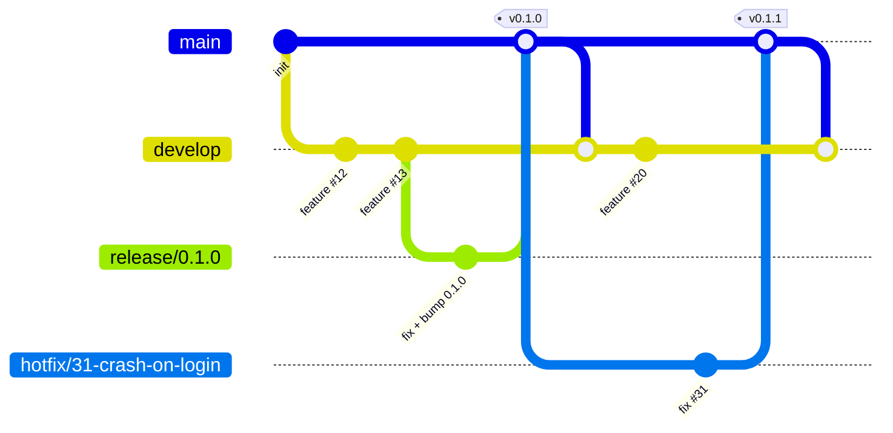

# Development workflow

> How work moves from a ticket to a release in this project. Claude sessions (`implement-ticket`, `coordinator`) and people follow this file; keep it current.

## 1. Requirements

| Tool | Version | Check |
|---|---|---|
| <e.g. Node.js> | <e.g. 22.x> | `node --version` |

## 2. Commands

| Task | Command |
|---|---|
| Install dependencies | |
| Build | |
| Lint | |
| Test (full suite) | |
| Run locally | |

<Until the bootstrap task creates the project, these are the planned commands. That task makes them real and updates this table.>

## 3. Branches

Git Flow, adapted for a project worked on by Claude sessions.

| Branch | Purpose | Created from | Merges into | Lives |
|---|---|---|---|---|
| `main` | **Released code only.** Starts at the initial commit and changes only when a release or hotfix merges in. Every such merge is tagged `vX.Y.Z`. | — | — | permanently |
| `develop` | **Integration branch** and the repo's GitHub default branch. Every ticket PR targets it and is tested before merging; it must always build and pass the full test suite. | `main` (initial commit) | `release/*` (by branching off) | permanently |
| `feature/<n>-<slug>`, `fix/…`, `refactor/…`, `docs/…`, `chore/…` | One ticket each | latest `origin/develop` | `develop` (squash) | until merged |
| `release/<X.Y.Z>` | **Stabilizes one milestone:** bug fixes, version bump and changelog only; no new features | `develop`, once the milestone's tickets are merged | `main` (merge commit + tag), then back into `develop` | until released |
| `hotfix/<n>-<slug>` | **Urgent fix to the released version** | latest `origin/main` | `main` (merge commit + tag), then `develop` and any open `release/*` | until released |

Rules:
- Nobody commits directly to `main` or `develop`; everything goes through a PR.
- Every new branch starts from the **latest remote version** of its base: `git fetch origin <base>`, then `git switch -c <branch> origin/<base>`.
- Ticket PRs **squash-merge** into `develop`. Release and hotfix PRs merge into `main` with a **merge commit** (no squash), so each release is one visible merge and `main` merges back into `develop` cleanly.
- After every merge into `main`, merge `main` back into `develop` (a PR) right away.

## 4. Versions and milestones

[Semantic Versioning](https://semver.org): `MAJOR.MINOR.PATCH`. `0.x` until the first stable release; MINOR for a milestone with new features; PATCH for hotfixes (e.g. `1.5.0` → `1.5.1`).

Each GitHub milestone is one release:

| Milestone | Version | Goal | Status |
|---|---|---|---|
| <MVP> | <0.1.0> | <one line> | planned |

## 5. Release process

1. Every ticket in the milestone is closed and `develop` is green.
2. Cut the release branch: `git fetch origin develop`, `git switch -c release/X.Y.Z origin/develop`. Bump the version, update `CHANGELOG.md`, push, and open a PR into `main`.
3. Only fixes go into the release branch (PRs into `release/X.Y.Z`), each also needed on `develop` (it comes back with step 5).
4. When it's ready: merge the PR into `main` (merge commit), tag `vX.Y.Z` on `main`, and publish a GitHub release with the changelog.
5. Merge `main` back into `develop`, delete the release branch, and close the milestone.

## 6. Hotfix process

1. A ticket labelled `hotfix` describes the bug in the released version.
2. Branch `hotfix/<n>-<slug>` from the latest `origin/main`. Add a test that reproduces the bug, fix it, bump PATCH, and update `CHANGELOG.md`.
3. PR into `main`; merge (merge commit), tag, publish the release.
4. Merge `main` back into `develop`, and into the open `release/*` branch if there is one.

## 7. Approvals

The owner explicitly approves every step that merges into `main` or a `release/*` branch, pushes a tag, publishes a GitHub release or changes repo settings. The coordinator only merges ticket PRs into `develop`.

## 8. Tickets, PRs and tests

- One ticket = one branch = one PR into `develop`, with `Closes #<n>` in the body.
- Ticket test cases (IDs like `T3-TC02`) become automated tests with the ID in the test name. A ticket closes only when all of them pass.
- Branch, commit and PR naming follow the owner's conventions (Conventional Commits, `#<n>` in commit scopes and PR titles).

## 9. CI

<What runs on PRs into `develop`, `release/*` and `main`. Until CI exists, run the full test suite locally before every merge.>
